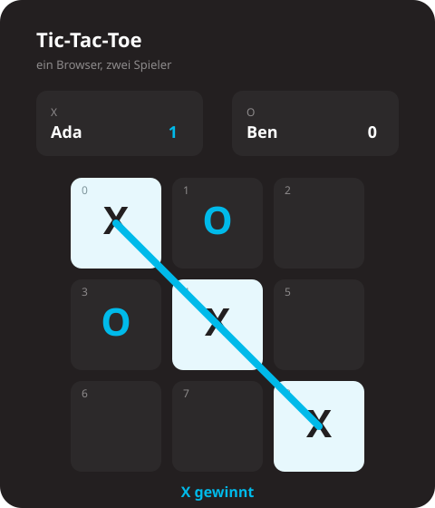

# Aufgabe

## Das Spiel

Tic-Tac-Toe. Zwei Personen, ein Browser. Die React-App spielt das Spiel selbst: Brett, Züge, Sieger. Der Server merkt sich nur das Ergebnis, wenn ein Spiel zu Ende ist.

Neun Felder, Index `0` bis `8`, Zeile für Zeile. Ein Feld ist leer, `X` oder `O`. `X` beginnt. Das ist die Person aus `player_a`. Die Person aus `player_b` spielt `O`.

Drei gleiche Zeichen in einer Zeile, Spalte oder Diagonale gewinnen. Ist das Brett voll und niemand hat drei, ist es unentschieden.

Am Ende schickt die App das fertige Spiel an den Server: beide Namen, das Brett mit neun Feldern und den Sieger. Bei einem Unentschieden ist der Sieger `"draw"`.

Ada (X) gewinnt. Die Zahlen in den Feldern sind die Indizes.

## Auftrag

Umgesetzt. Dieselbe Architektur wie `POST /users`. Repository, Service, Router, im Paket `app/`. Die JSON-Formen stehen in `app/schemas.py`. Die Zeilen stehen in `app/domain/models.py`.

1. Profil anlegen und lesen. `POST /profiles` mit `ProfileCreate`. `GET /profiles`.
2. User lesen. `GET /users`.
3. Verlauf speichern. `POST /game-histories` mit `GameHistoryCreate`. Die `id` vergibt der Server. Abweisen, wenn ein Name leer ist, beide Namen gleich sind, das Brett nicht neun Felder hat, ein Feld ungültig ist oder der Sieger weder ein Spieler noch `"draw"` ist.
4. Verlauf lesen. `GET /game-histories` und `GET /game-histories/{history_id}`. Unbekannte Id: **404**.
